# COVR campaign: 10 ads + 6 hook tests

Built from the master prompt. Every ad comes in **4:5** (`_4x5.png`, feed) and **9:16** (`_9x16.png`, Stories/Reels; text kept out of the top 240 px and bottom 340 px). The product is never redrawn: every cover you see is from your original photos, cropped and laid out, not AI-generated.

Funnel split: **TOFU 3 · MOFU 4 · BOFU 3**.

| | |
|---|---|
| 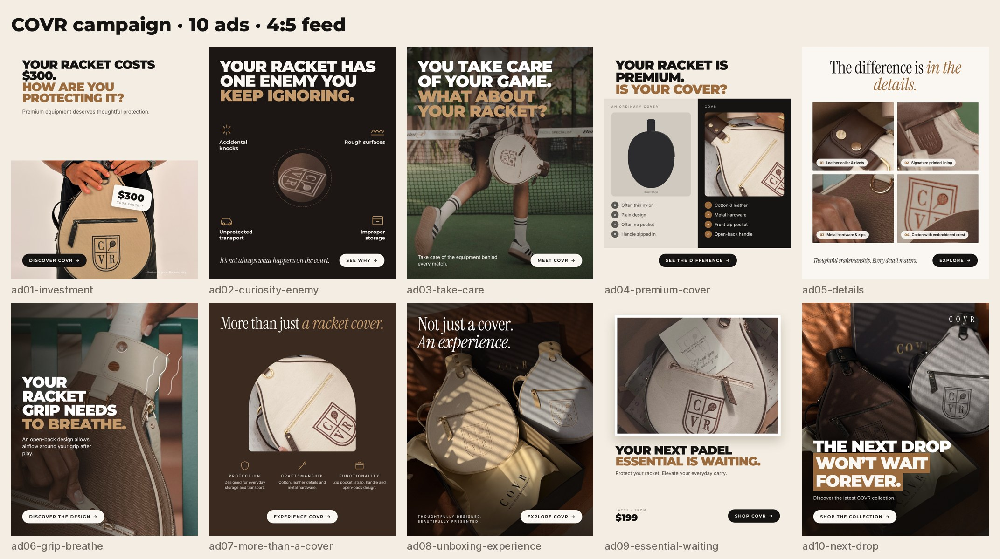 | 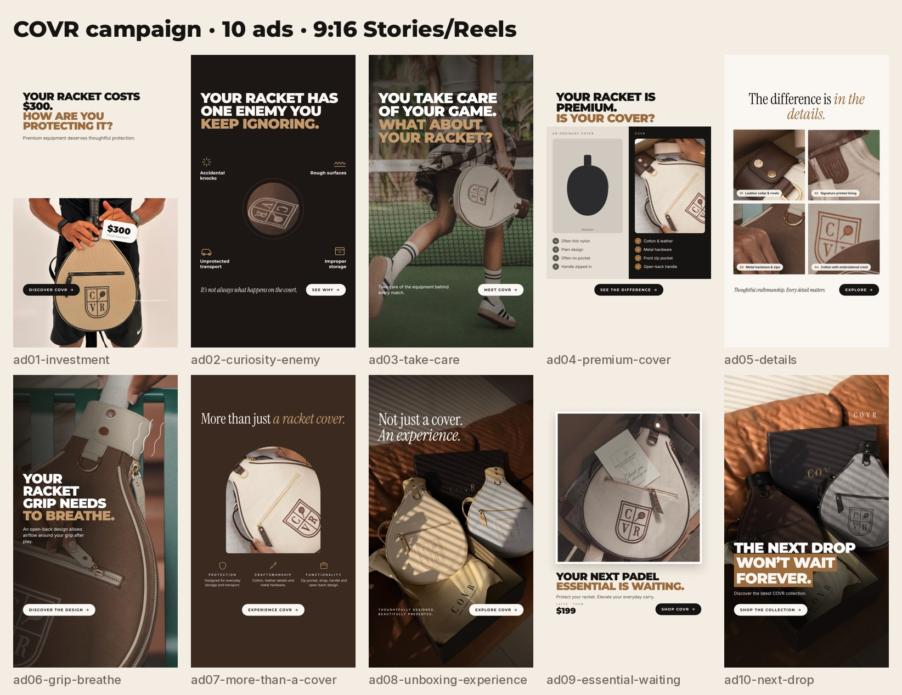 |

**Facts used:** only Shopify product data and padelcovr.com copy: cotton/canvas body, leather trim, metal hardware, printed lining, front zip pocket, adjustable strap, carry handle, D-ring, open-back handle, waterproof lining, box + dust bag, $199. No invented reviews, discounts, stock counts or certifications.

---

## AD 01 · Investment protection
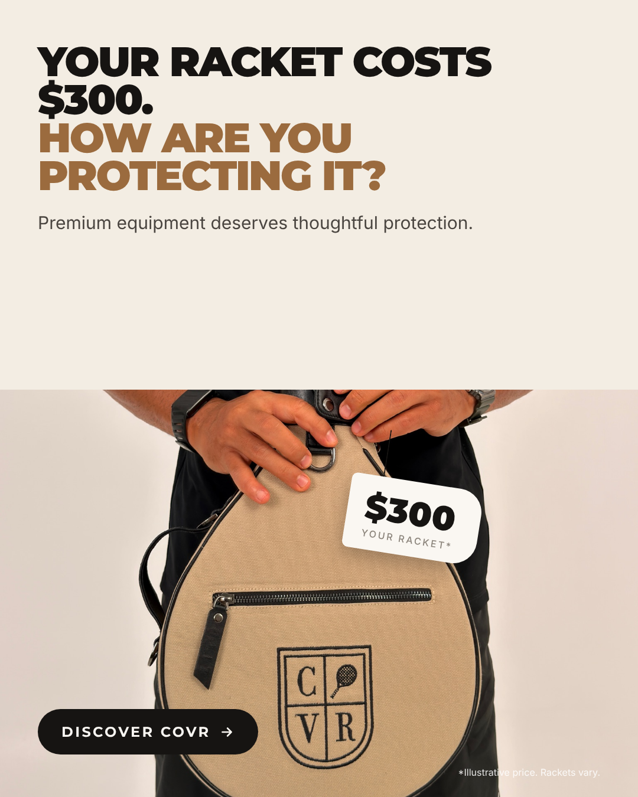
- **Stage:** TOFU · **Angle:** your racket is an investment · **Trigger:** loss aversion
- **Headline:** YOUR RACKET COSTS $300. HOW ARE YOU PROTECTING IT?
- **Primary text:** You researched the weight, the balance, the shape. Then it goes in the car boot with your keys and shoes. COVR is a cotton-and-leather racket cover with a waterproof lining, made to protect the racket you chose so carefully. Premium equipment deserves thoughtful protection.
- **CTA:** Learn more ("Discover COVR")
- **Why it could work:** A price tag on the grip turns a vague worry into a number. People protect what they can see is valuable.
- **Alt headlines (rendered as hook tests):** "A $300 racket. A $20 plan to protect it?" · "Would you carry a $300 watch loose in your bag?"
- Note: $300 is marked on the ad as an illustrative price.

## AD 02 · Curiosity: one enemy
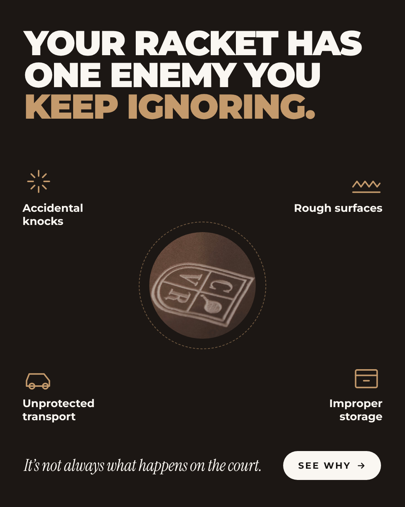
- **Stage:** TOFU · **Angle:** damage happens off court · **Trigger:** curiosity gap
- **Headline:** YOUR RACKET HAS ONE ENEMY YOU KEEP IGNORING.
- **Primary text:** It isn't the glass or the smash you mistimed. It's everything between matches: knocks in the boot, rough benches, loose keys, a corner of the cupboard. COVR gives your racket a padded cotton-and-leather home for the trip. It's not always what happens on the court.
- **CTA:** Learn more ("See why protection matters")
- **Why it could work:** The headline opens a loop the reader wants closed. The four icons answer it without fear-mongering.
- **Alt headline:** "Most racket wear doesn't happen during the match."

## AD 03 · You take care of your game
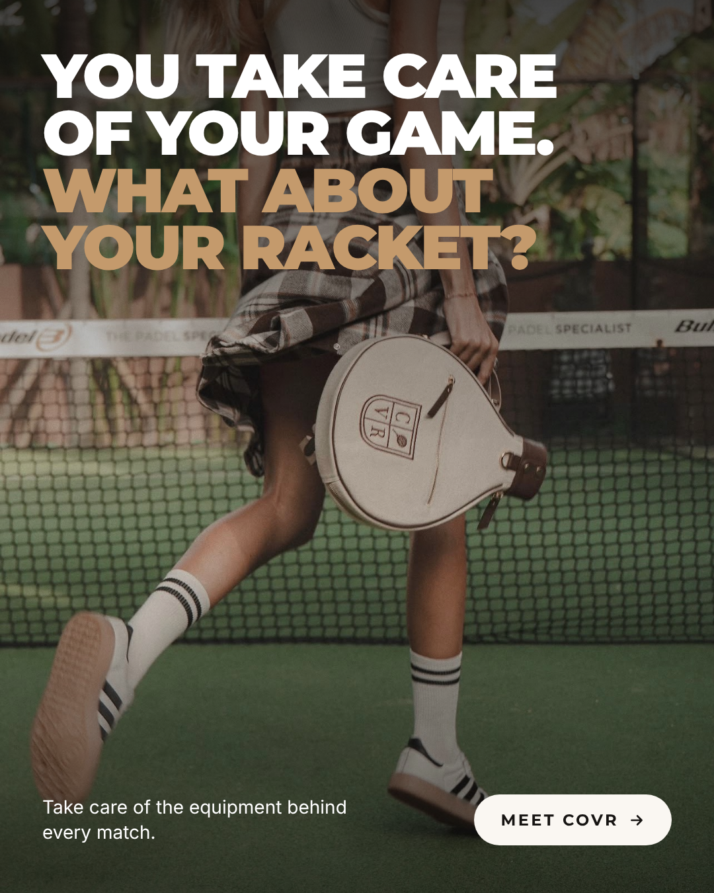
- **Stage:** TOFU · **Angle:** identity of the serious player · **Trigger:** identity / aspiration
- **Headline:** YOU TAKE CARE OF YOUR GAME. WHAT ABOUT YOUR RACKET?
- **Primary text:** Early sessions. Drills. The right shoes. You take your padel seriously. COVR is for the equipment behind every match: cotton canvas, leather details, metal hardware and a front pocket for your phone and keys. Take care of the racket that takes care of your game.
- **CTA:** Learn more ("Meet COVR")
- **Why it could work:** It reads like a sports campaign, not a product ad, and flatters the player's self-image before it sells.
- **Alt headline:** "Serious about padel? Your racket can tell."

## AD 04 · Is your cover premium?
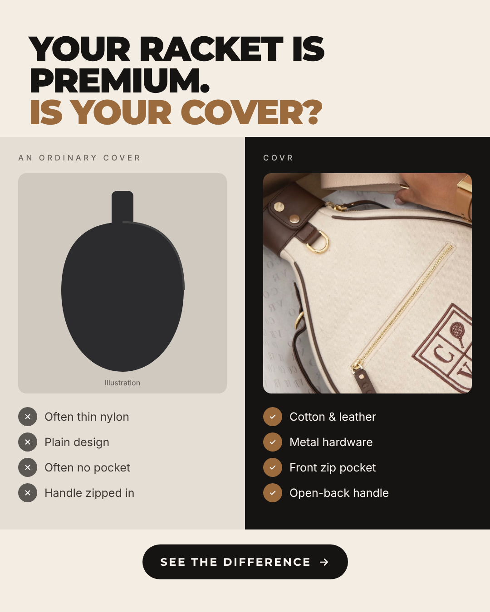
- **Stage:** MOFU · **Angle:** ordinary cover vs COVR · **Trigger:** contrast / self-reflection
- **Headline:** YOUR RACKET IS PREMIUM. IS YOUR COVER?
- **Primary text:** Many standard covers are a single layer of nylon with a zip. COVR is cotton canvas with leather trim, metal hardware, a waterproof lining, a front zip pocket and an open-back handle that lets your grip breathe. Same racket. Very different home for it.
- **CTA:** Learn more ("See the difference")
- **Why it could work:** A split screen is one of the highest hit-rate static formats. The left side is an *illustration*, not a named competitor, and says "often", not "all".
- **Alt headlines (rendered):** "Would you put a $300 racket in a $20 bag?" · "Same racket. Very different cover."

## AD 05 · The difference is in the details
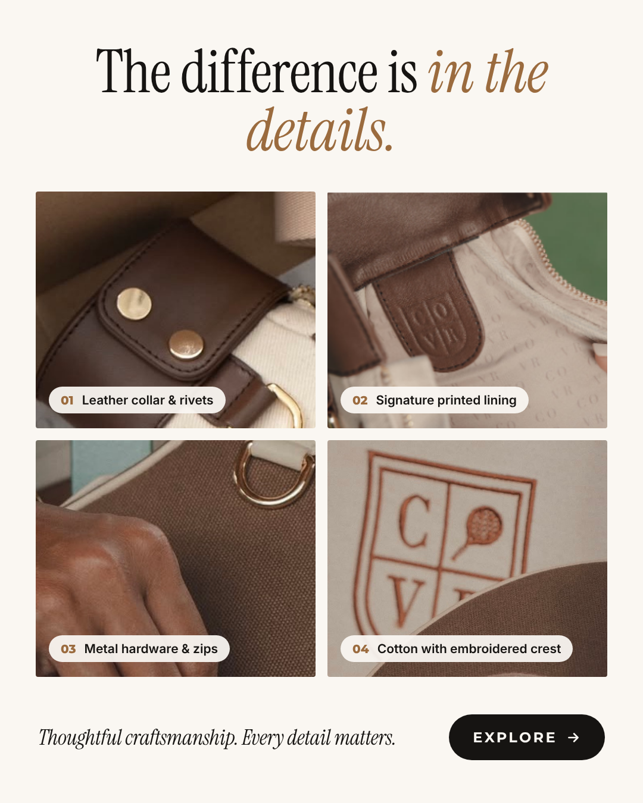
- **Stage:** MOFU · **Angle:** craftsmanship · **Trigger:** perceived quality
- **Headline:** The difference is in the details.
- **Primary text:** Leather collar with metal rivets. A signature printed lining. Metal zips and hardware. Embroidered crest on cotton canvas. Every COVR is built from details you notice the first time you hold it, and keep noticing after. Thoughtful craftsmanship. Every detail matters.
- **CTA:** Shop now ("Explore the collection")
- **Why it could work:** Close-ups justify the price before the price is shown. An editorial grid looks like a fashion brand, not a sports accessory.
- **Alt headline:** "Look closer."

## AD 06 · Your grip needs to breathe
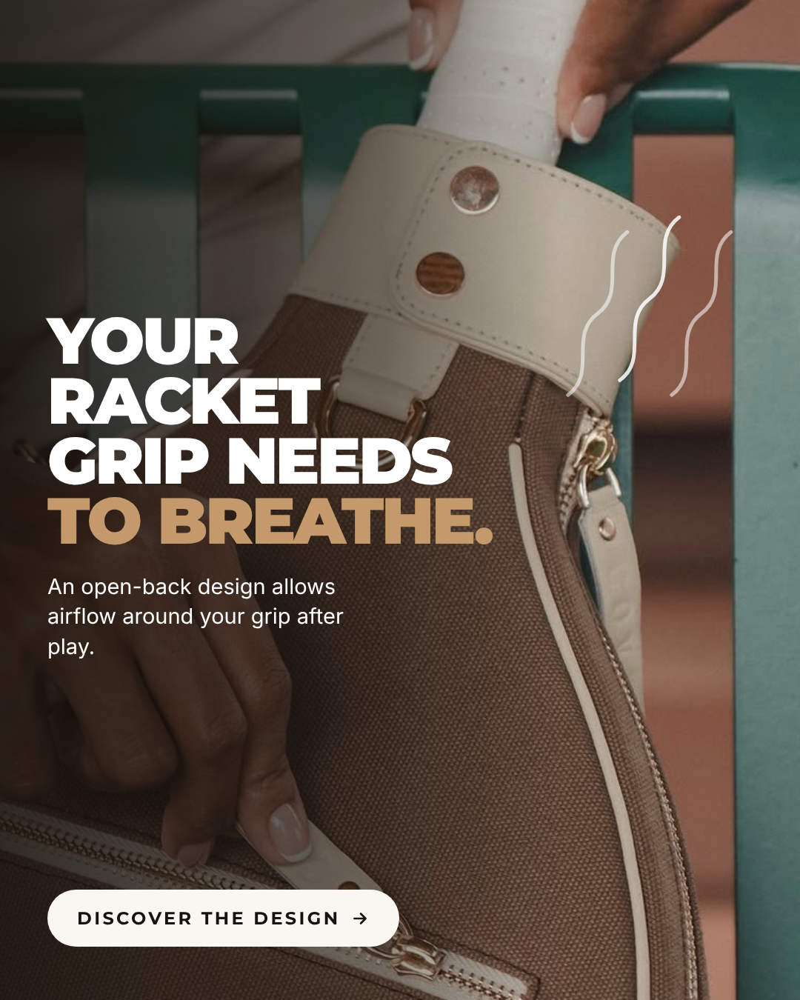
- **Stage:** MOFU · **Angle:** open-back handle · **Trigger:** product discovery / differentiation
- **Headline:** YOUR RACKET GRIP NEEDS TO BREATHE.
- **Primary text:** Most covers zip the whole racket in, grip included. COVR's open-back leather collar leaves the handle exposed, so air can move around your grip after play. A small design decision you'll appreciate every time you unpack.
- **CTA:** Learn more ("Discover the design")
- **Why it could work:** It's a feature most players have never thought about, so it's genuinely new information. The copy says "allows airflow", not "prevents odour".
- **Alt headlines (rendered):** "Why is your grip zipped in after every match?" · "Let your grip breathe after play."
- ⚠️ Photo is the **Mocha** cover, which is at **0 stock**. The feature applies to every colour, but restock Mocha before running, or I'll swap in another colour.

## AD 07 · More than just a racket cover
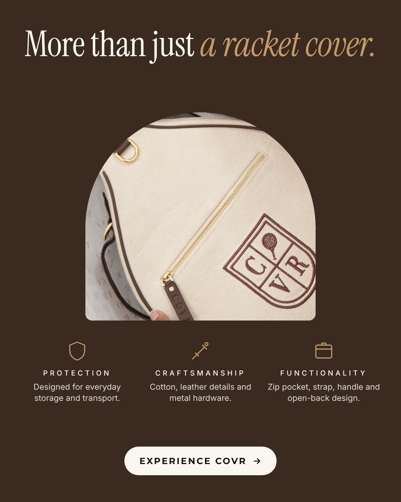
- **Stage:** MOFU · **Angle:** value justification · **Trigger:** three-pillar reasoning
- **Headline:** More than just a racket cover.
- **Primary text:** Protection for everyday storage and transport. Craftsmanship in cotton, leather and metal hardware. Function in a front zip pocket, adjustable strap, carry handle and open-back design. COVR is what a racket cover looks like when every part has a reason.
- **CTA:** Shop now ("Experience COVR")
- **Why it could work:** It answers "why $199?" in three words before anyone asks. The arch frame and chocolate background read as luxury.
- **Alt headline:** "Protection. Craft. Function. One cover."

## AD 08 · Not just a cover. An experience.
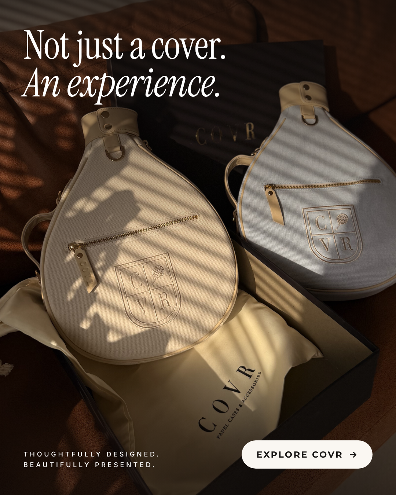
- **Stage:** BOFU · **Angle:** unboxing & gifting · **Trigger:** premium ownership
- **Headline:** Not just a cover. An experience.
- **Primary text:** Every COVR arrives in its box, wrapped in a dust bag, ready to keep or ready to give. Natural canvas, leather details, metal hardware. The kind of gift a padel player actually uses every week. Thoughtfully designed. Beautifully presented.
- **CTA:** Shop now ("Explore COVR")
- **Why it could work:** Unboxing ranks among the top formats. Your warm, real light makes the product look worth the price.
- **Alt headline:** "The padel gift that actually gets used."

## AD 09 · Your next padel essential is waiting
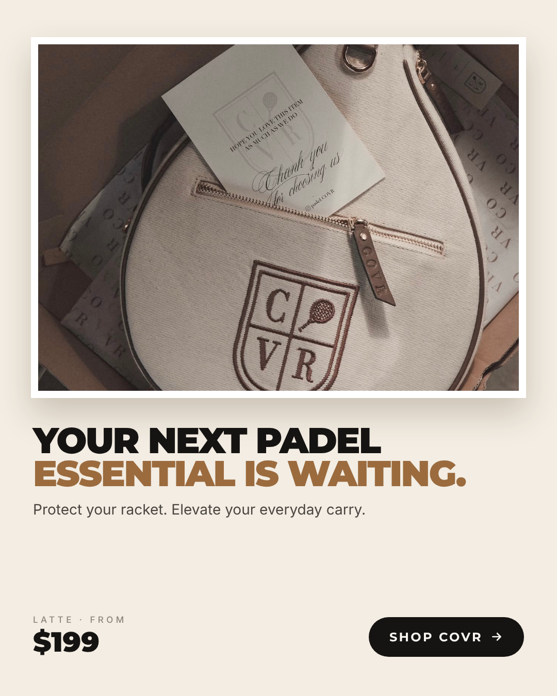
- **Stage:** BOFU · **Angle:** ownership · **Trigger:** desire / imagined ownership
- **Headline:** YOUR NEXT PADEL ESSENTIAL IS WAITING.
- **Primary text:** Latte: undyed natural canvas, dark brown leather, gold hardware. Waterproof lining, front zip pocket, adjustable strap. It protects your racket, carries your phone and keys, and looks better every season. Protect your racket. Elevate your everyday carry.
- **CTA:** Shop now
- **Why it could work:** For warm audiences, a clean framed product with the price removes the last question. Latte has 5 in stock.
- **Alt headline:** "Meet your racket's new home."

## AD 10 · The next drop won't wait forever
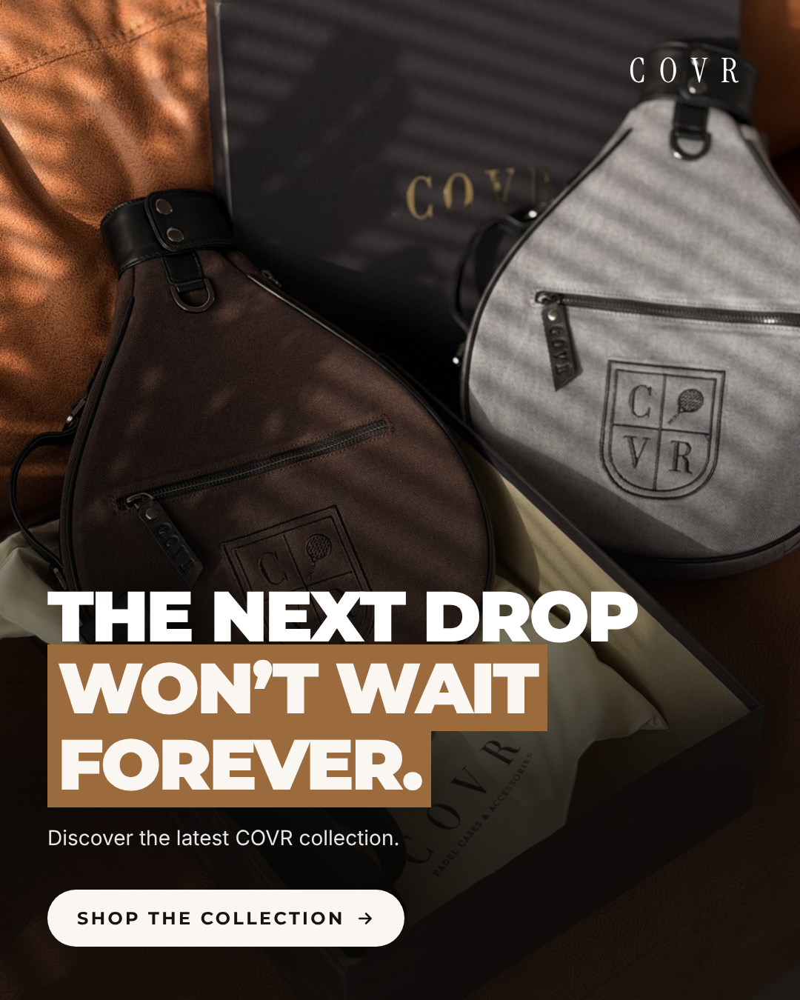
- **Stage:** BOFU · **Angle:** limited drop · **Trigger:** scarcity
- **Headline:** THE NEXT DROP WON'T WAIT FOREVER.
- **Primary text:** A new COVR drop, made in small batches: cotton canvas, leather details, metal hardware, boxed with a dust bag. When this run is gone, the next one takes time. Discover the latest COVR collection.
- **CTA:** Shop now ("Shop the collection")
- **Why it could work:** Real scarcity converts warm audiences who have been waiting.
- ⚠️ **Run only with a genuine limited drop.** Several colours really are low right now (Total Black, Vanilla Cream and Coffee at 1 each), but stock changes, so the ad deliberately states no numbers. Confirm "small batches" is true before using that line.
- **Alt headline:** "Some colours won't be back soon."

---

## Hook tests (6 extra creatives)
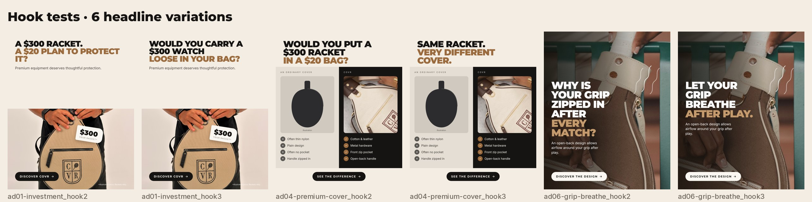

The three strongest concepts (01, 04, 06) each get two extra headlines, with the same image and layout. Test the three headlines of each concept in one ad set. If one headline wins clearly, the hook is what drives results. If they all perform the same, the photo or angle is doing the work.

| Concept | Original | Hook 2 | Hook 3 |
|---|---|---|---|
| 01 Investment | Your racket costs $300. How are you protecting it? | A $300 racket. A $20 plan to protect it? | Would you carry a $300 watch loose in your bag? |
| 04 Comparison | Your racket is premium. Is your cover? | Would you put a $300 racket in a $20 bag? | Same racket. Very different cover. |
| 06 Grip | Your racket grip needs to breathe. | Why is your grip zipped in after every match? | Let your grip breathe after play. |

**Total: 10 ads × 2 sizes + 6 hook variations = 26 files.**

## Before launch
- **Checkout:** Shopify shows paid orders on 9 and 10 Oct 2026, so checkout is processing payments. Still place one real test order from a phone (Instagram in-app browser) before spending.
- **Stock:** Mocha 0, Total Black 1, Vanilla Cream 1, Coffee 1, Ash 2, Baby Pink 2, Sky Denim 3, Navy 4, Latte 5, Ginger 7 (Shopify, 11 Oct 2026).
- **Edit or re-render:** change text in `creative/ads3.js`, then run `node creative/build.js ad` (all campaign ads) or `node creative/build.js ad06` (one).
